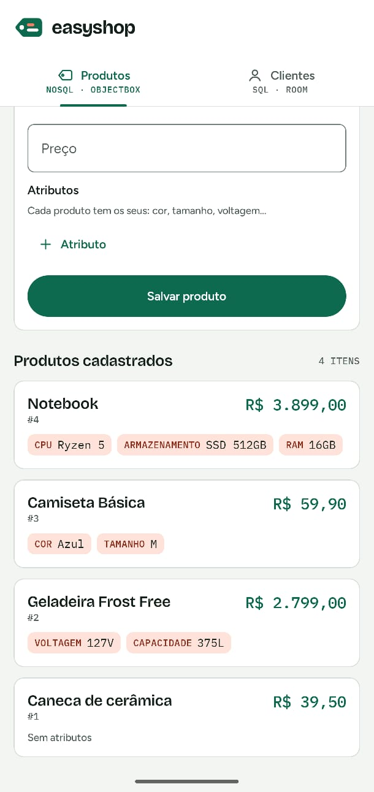
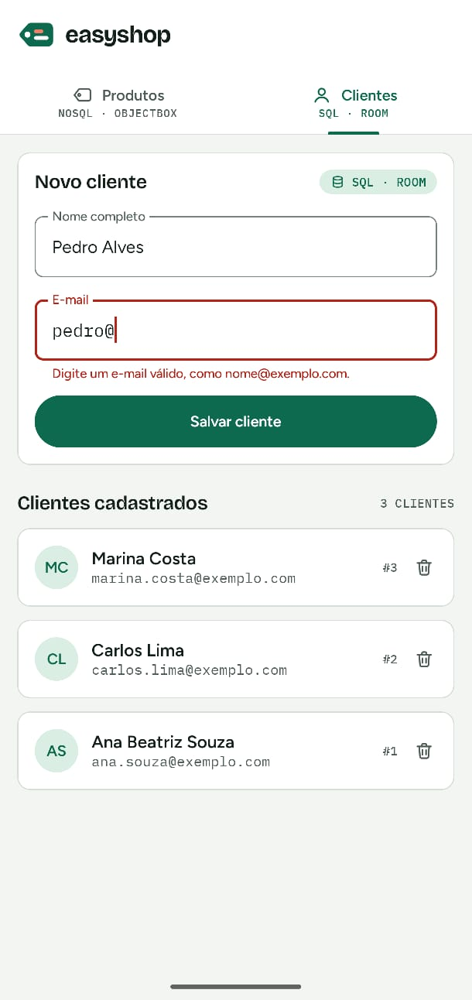
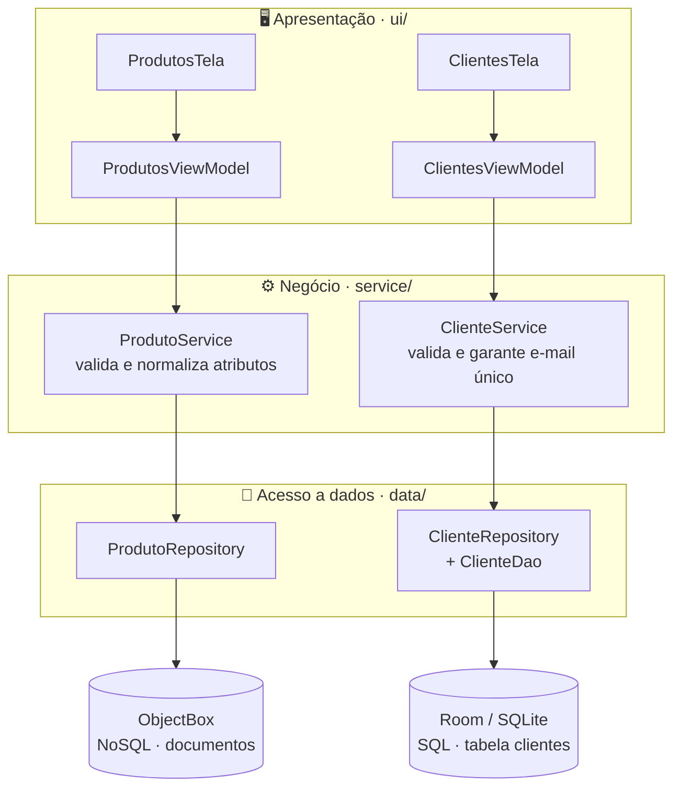
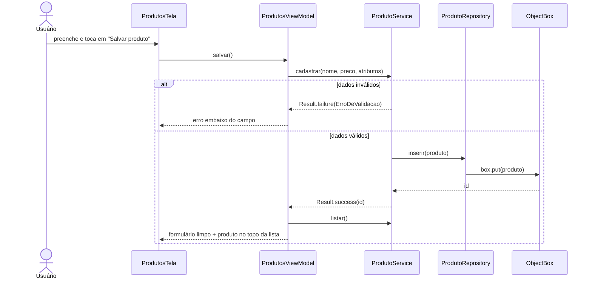

<p align="center">
  <picture>
    <source media="(prefers-color-scheme: dark)" srcset="docs/logo-escuro.svg">
    
  </picture>
</p>

<h3 align="center">Arquitetura Poliglota com Bancos SQL e NoSQL Locais</h3>

<p align="center">
  Protótipo Android de um mini e-commerce que usa <b>dois bancos locais ao mesmo tempo</b>:<br>
  <b>NoSQL (ObjectBox)</b> para o catálogo de produtos e <b>SQL (Room/SQLite)</b> para o cadastro de clientes.
</p>

<p align="center">
  
  
  
  
  
</p>

<p align="center">
        🎬 <b>Vídeo de demonstração no emulador:</b> <a href="https://youtu.be/cymqL9abGfs">YouTube</a> · <a href="https://drive.google.com/file/d/1TtqdEv2OMjJ_TqWHV8AWQMzloP34laZv/view?usp=drive_link">Google Drive</a>
</p>

---

## 👥 Equipe

| Nome completo | Responsabilidade |
| --- | --- |
| Gabriel Assis Costa de Souza | Produtos (NoSQL): entidade `Produto`, store do ObjectBox, `ProdutoRepository` e `ProdutoService` |
| Luis Felipe de Oliveira Brasil | Clientes (SQL): entidade `ClienteEntity`, `ClienteDao`, `EasyShopDatabase`, `ClienteRepository` e `ClienteService` |
| Gabriel Silva de Souza Claro | Apresentação: interface em Jetpack Compose, ViewModels, identidade visual, README e vídeo |

---

## 🧩 O problema

A EasyShop salvava **tudo** em um único banco relacional local: clientes, compras e o catálogo completo de produtos.

O catálogo é o ponto fraco desse modelo. Cada produto tem características diferentes: uma camiseta tem *tamanho* e *cor*, um notebook tem *memória RAM* e *processador*, uma geladeira tem *voltagem*. Para caber em tabelas fixas, cada categoria nova exigia **mudar o schema**, com colunas quase sempre nulas ou tabelas intermediárias (modelo EAV). O resultado era um app lento, difícil de manter e sujeito a falhas.

## 💡 A solução: persistência poliglota

Cada tipo de dado vai para o banco que combina com a sua natureza, **no mesmo app e no mesmo aparelho**:

| Dado | Natureza | Banco | Por quê |
| --- | --- | --- | --- |
| **Produtos** | Semiestruturado: os atributos mudam de um produto para outro | **ObjectBox** (NoSQL, documentos) | Os atributos são um `Map<String, String>` guardado como propriedade *flex*, sem schema fixo. Produto com atributos novos **não exige migração**. |
| **Clientes** | Estruturado: sempre nome e e-mail | **Room / SQLite** (SQL, relacional) | Tabela com tipos definidos, chave primária e **índice único no e-mail**: o próprio banco garante a consistência. |

**Na prática**, dois produtos com atributos totalmente diferentes vivem na mesma coleção, sem nenhuma alteração de estrutura:

```text
Produto #1  { nome: "Camiseta básica", preco: 59.90,   atributos: { tamanho: "M",     cor: "azul"    } }
Produto #2  { nome: "Notebook",        preco: 3899.00, atributos: { ram:     "16 GB", cpu: "Ryzen 5" } }
```

Já o cliente segue uma tabela rígida, validada pelo SQLite:

```sql
CREATE TABLE clientes (
    id           INTEGER PRIMARY KEY AUTOINCREMENT,
    nomeCompleto TEXT NOT NULL,
    email        TEXT NOT NULL
);
CREATE UNIQUE INDEX index_clientes_email ON clientes (email);  -- gerado pelo Room
```

---

## 📱 Funcionalidades

O app tem duas abas. Cada uma mostra de qual banco vêm os dados.

| Aba | Formulário | Listagem |
| --- | --- | --- |
| **Produtos** · NoSQL | Nome, preço e atributos opcionais. O botão **"+ Atributo"** adiciona quantos pares *chave/valor* forem necessários. | Produtos lidos do ObjectBox, do mais novo para o mais antigo, com os atributos de cada um em etiquetas. |
| **Clientes** · SQL | Nome completo e e-mail. | Clientes lidos do Room. A lista **atualiza sozinha** (via `Flow`) a cada cadastro ou exclusão, que pede confirmação. |

<p align="center">
  
  &nbsp;&nbsp;
  
</p>

Os erros de validação aparecem **embaixo do campo** que causou o problema. A interface segue o modo claro/escuro do sistema e se adapta à largura da tela: uma coluna no celular e duas ou três no tablet.

---

## 🏛️ Arquitetura em camadas

O projeto separa as responsabilidades em três camadas. Cada camada só conversa com a camada logo abaixo dela.



| Camada | Pacote | Responsabilidade | O que **não** faz |
| --- | --- | --- | --- |
| **Apresentação** | `ui/` | Telas em Compose desenham um estado (`ProdutosUiState`, `ClientesUiState`). Os ViewModels recebem as ações do usuário e chamam os Services. | Não conhece ObjectBox, Room nem SQL. Não tem regra de negócio. |
| **Negócio** | `service/` | Valida, normaliza e decide. Devolve `Result<Long>`: sucesso com o ID ou falha com `ErroDeValidacao`, que diz o campo e a mensagem. | Não acessa o banco diretamente: usa os Repositories por interface (`ProdutoDados`, `ClienteDados`). |
| **Acesso a dados** | `data/` | Somente CRUD: inserir, listar, buscar e excluir. | Não valida nada. |

As dependências são montadas uma única vez pelo `ServiceLocator`, chamado em `EasyShopApp.onCreate()`. Não usamos Hilt: seria exagero para o tamanho do projeto.

### Fluxo de um cadastro de produto



### Estrutura de pastas

```text
app/src/main/java/com/example/easyshop/
├── EasyShopApp.kt              # Application: inicia o ObjectBox e o ServiceLocator
├── MainActivity.kt             # única Activity; abre a TelaPrincipal
├── ServiceLocator.kt           # monta Services e Repositories (sem Hilt)
│
├── ui/                         # ── APRESENTAÇÃO ──
│   ├── TelaPrincipal.kt        # barra com a marca + abas Produtos/Clientes
│   ├── produtos/               # ProdutosTela, ProdutoFormulario ("+ Atributo"), ProdutoCard,
│   │                           # ProdutosViewModel, ProdutosUiState
│   ├── clientes/               # ClientesTela, ClientesViewModel, ClientesUiState
│   ├── componentes/            # CampoTexto, BotaoSalvar, SeloDoBanco, TituloDaLista, EstadoVazio
│   └── theme/                  # cores, fontes e formas do design system
│
├── service/                    # ── NEGÓCIO ──
│   ├── ProdutoService.kt       # contrato  + ProdutoServiceImpl.kt
│   ├── ClienteService.kt       # contrato  + ClienteServiceImpl.kt
│   └── ErroDeValidacao.kt      # erro com o campo (NOME, PRECO, EMAIL) para a UI
│
└── data/                       # ── ACESSO A DADOS ──
    ├── nosql/                  # Produto (@Entity ObjectBox), ObjectBox (store), ProdutoRepository
    ├── local/                  # ClienteEntity (@Entity Room), ClienteDao, EasyShopDatabase
    └── repository/             # ClienteRepository
```

---

## ✅ Regras de negócio

Todas ficam nos Services. A interface só mostra o resultado.

| Aba | Regra | Mensagem ao usuário |
| --- | --- | --- |
| Produtos | Nome obrigatório | *Informe o nome do produto.* |
| Produtos | Preço maior que zero (aceita vírgula: `12,90`) | *O preço deve ser maior que zero.* |
| Produtos | Atributos: espaços extras removidos, chave vazia descartada, chave repetida (sem diferenciar maiúsculas) mantém a última | (ajuste silencioso) |
| Clientes | Nome obrigatório (espaços duplicados são removidos) | *Informe o nome completo.* |
| Clientes | E-mail no formato `nome@dominio.ext`, salvo em minúsculas | *Digite um e-mail válido, como nome@exemplo.com.* |
| Clientes | E-mail único: consulta antes de inserir **e** índice único no SQLite como garantia final | *Este e-mail já está cadastrado.* |

---

## 🛠️ Stack

| Item | Versão / escolha |
| --- | --- |
| Linguagem | Kotlin (com Coroutines 1.10.2 e Flow) |
| Interface | Jetpack Compose + Material 3, ViewModel do Android Lifecycle |
| Banco SQL | **Room 2.8.5** sobre SQLite, com KSP 2.3.13 |
| Banco NoSQL | **ObjectBox 5.4.2** (documentos, propriedade *flex* para os atributos) |
| Build | Android Gradle Plugin 9.5.1, Gradle 9.6.0, Java 17 |
| Android | `minSdk 26` (Android 8.0), `targetSdk 36`, `compileSdk 37` |

---

## ▶️ Como executar

### Pré-requisitos

- **Android Studio Rabbit 2 (2026.2.2) Patch 1 ou mais novo.** Versões anteriores não aceitam o AGP 9.5.1 do projeto e o sync falha.
- Um **emulador** (ou aparelho) com Android 8.0 / API 26 ou superior.

### Pelo Android Studio

1. Clone o repositório:
   ```bash
   git clone https://github.com/1GabrielSouza/easy-shop.git
   ```
2. No Android Studio, use **File › Open** e escolha a pasta `easy-shop`.
3. Espere o **Gradle Sync** terminar. Na primeira vez ele baixa as dependências e leva alguns minutos.
4. Em **Device Manager**, crie ou escolha um emulador.
5. Selecione a configuração **app** e clique em **Run ▶**.

### Pela linha de comando

Com um emulador já aberto:

```bash
./gradlew installDebug        # Windows: gradlew.bat installDebug
```

### Roteiro rápido de teste

1. **Produtos:** cadastre `Camiseta básica`, `59,90`, com os atributos `tamanho = M` e `cor = azul`. Depois cadastre `Notebook`, `3899`, com `ram = 16 GB` e `cpu = Ryzen 5`. São dois documentos com atributos diferentes na mesma coleção.
2. **Clientes:** cadastre `Ana Souza` / `ana@exemplo.com`. Tente `ana@` (formato inválido) e depois `ANA@exemplo.com` (duplicado).
3. **Persistência:** feche o app (remova-o dos recentes) e abra de novo. Os produtos e clientes continuam lá.

### Onde ver os dados

- **SQL:** em **App Inspection › Database Inspector**, abra `easyshop.db` › tabela `clientes`.
- **NoSQL:** os arquivos do ObjectBox ficam em `/data/data/com.example.easyshop/files/objectbox/`, visíveis pelo **Device Explorer**.

---

## 🧪 Testes

| Comando | O que roda |
| --- | --- |
| `./gradlew test` | **15 testes de unidade** dos Services, na JVM e com repositórios falsos em memória: 7 do `ProdutoService` e 8 do `ClienteService` (validações, normalização, e-mail duplicado, ordem da lista). |
| `./gradlew connectedAndroidTest` | **4 testes instrumentados** do `ProdutoRepository` com ObjectBox real, incluindo produtos com atributos diferentes lidos de volta iguais. Precisa de emulador aberto. |

---

## 🧭 Decisões de projeto

- **ObjectBox em vez de Realm.** O enunciado cita o Realm, mas a MongoDB descontinuou os Atlas Device SDKs (Realm) em setembro de 2025. O ObjectBox aceita `Map<String, String>` direto na entidade e grava como propriedade *flex*, exatamente o que os atributos dinâmicos pedem.
- **Room em vez de SQLite puro.** As consultas são verificadas na compilação, e a listagem devolve um `Flow`, então a tela de clientes se atualiza sozinha.
- **Contraste entre os bancos, visível no código.** A lista de clientes é *reativa* (Flow do Room). A de produtos é *relida* depois de cada cadastro, porque a consulta do ObjectBox usada aqui (`box.all`) devolve uma lista pronta.
- **Services dependem de interfaces** (`ProdutoDados`, `ClienteDados`), não do banco. Por isso as regras de negócio são testadas na JVM, sem emulador.
- **Erros com campo.** `ErroDeValidacao` informa qual campo falhou. Assim o ViewModel mostra a mensagem no lugar certo, sem a UI conhecer as regras.

---

## 🎨 Identidade visual

Logo "Etiqueta": uma etiqueta de preço com uma linha de *chave* e uma de *valor*, a mesma ideia dos atributos dinâmicos. Cor principal **Pinho `#0D6A4F`**. Fontes **Bricolage Grotesque** (títulos), **Figtree** (texto) e **IBM Plex Mono** (dados), todas sob licença OFL e incluídas em `res/font`.

---

<p align="center"><sub>Trabalho acadêmico · Arquitetura Poliglota com Bancos SQL e NoSQL Locais</sub></p>
